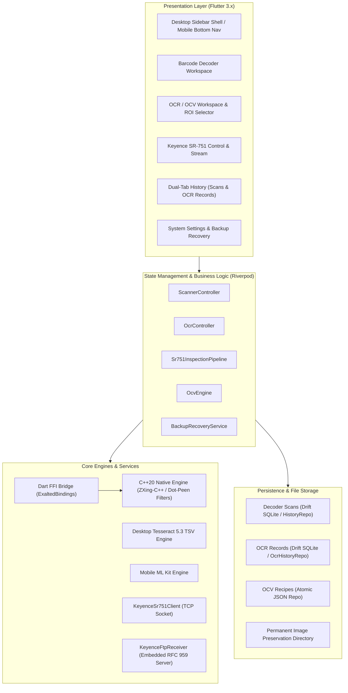

# Exalted Machine Vision Platform — Architecture & Platform Specification

Version: 1.0.0  
Product: Exalted (MatrixScan)  
Target Platforms: Linux Desktop (x86_64), Windows Desktop (x64), Android Mobile (ARM64 / ARMv7)

---

## 1. System Architecture Overview

Exalted is engineered as a unified, high-performance, cross-platform industrial software platform. Rather than maintaining disparate applications for each operating system, Exalted shares over **95% of its codebase** across Linux, Windows, and Android, isolating platform differences behind strict, zero-overhead adapter layers.

---

## 2. Cross-Platform Strategy & Native Isolation

Exalted operates natively across three primary targets:

| Target Platform | UI Runtime | Native Core Library | OCR Engine | Hardware Communication | Packaging Deliverable |
| :--- | :--- | :--- | :--- | :--- | :--- |
| **Linux Desktop** | Flutter GTK3 | `libexalted_ffi.so` | Tesseract 5.3 TSV (Host CLI/C-API) | TCP Socket / Embedded Dart FTP | Debian `.deb` & `.tar.gz` |
| **Windows Desktop** | Flutter Win32 | `exalted_ffi.dll` | Tesseract 5.3 TSV (Host CLI/DLL) | TCP Socket / Embedded Dart FTP | Inno Setup `.exe` Installer |
| **Android Mobile** | Flutter Android | `libexalted_ffi.so` (via NDK CMake) | Google ML Kit Offline OCR | CameraX / TCP Wi-Fi / Hotspot | Universal & Split APKs |

### Core Architectural Decisions:
1. **Unified State & Logic**: Scanning state machines, OCV rule evaluations, GS1 barcode parsing, image prep/cropping, and history persistence are completely platform-agnostic Dart code.
2. **Platform Separation via Strategy Pattern**:
   - `OcrEngine` defines an abstract interface.
   - On Linux/Windows desktop, `DesktopOcrEngine` executes offline Tesseract 5.3 and parses structured TSV streams.
   - On Android mobile, `MlKitOcrEngine` invokes on-device ML Kit text recognition.
3. **Responsive UI Shell**:
   - Screen width $\ge 900$ px: `DesktopAppShell` activates, providing a 220px fixed navigation rail, expandable inspector sidebar, and hardware status indicators.
   - Screen width $< 900$ px: `AppShell` activates, providing standard touch-friendly mobile bottom navigation.

---

## 3. C++20 Native Barcode Core & Dart FFI

The decoding core is written in modern **C++20** and compiled into a standalone shared library (`libexalted_ffi.so` / `exalted_ffi.dll`).

### Key Native Capabilities:
- **Zero-Copy Luminance Buffer Passing**: Grayscale frame buffers are passed by pointer directly from Flutter/Dart isolates into C++ memory without unnecessary memory copies.
- **Vendored ZXing-C++ Engine**: High-performance open-source readers for 1D and 2D codes with custom optimizations.
- **Dot-Peen Morphological Rank Filter**:
  Direct Part Marking (DPM) dot-peened codes on cast iron, steel, and aluminum frequently feature broken, disconnected dots. Exalted's C++ core applies a specialized rank-order morphological filter to dilate and link adjacent dots into standard ECC 200 modules prior to matrix traversal.
- **Strict ABI Stability**:
  The native interface is governed by `cpp/include/exalted/ffi_api.h` and versioned via `exalted_api_version()` (currently version 2). Symbols use `EXALTED_API` (`__declspec(dllexport)` on Windows, `__attribute__((visibility("default")))` on Linux/Android) with `extern "C"` linkage.

---

## 4. OCR & OCV Industrial Verification Engine

Exalted distinguishes itself from simple OCR utilities by featuring a deterministic **Optical Character Verification (OCV)** engine.

### Verification Flow:
1. **Image Preparation (`ImagePrep`)**:
   - Images are normalized and cropped using high-performance Flutter canvas primitives (`ui.PictureRecorder` and `ui.Canvas`).
   - Operators can define bounding box Regions of Interest (ROI) normalized to $[0.0, 1.0]$.
2. **TSV Parsing**:
   - The desktop engine captures word-level and character-level bounding boxes, line numbers, word numbers, and confidence ratings from Tesseract TSV streams.
3. **Rule Evaluation (`OcvEngine`)**:
   - Evaluates recognized strings against user-defined inspection recipes:
     - `ExactMatch`: Case-sensitive or insensitive comparison.
     - `Regex`: Industrial pattern matching.
     - `LotCode`: Batch/lot identifier structure.
     - `ExpiryDate`: Structural date verification + chronological comparison against current system date.
     - `NumericRange`: Numerical boundary checking.
4. **Explainable Character Diffs**:
   - Mismatches generate an array of `CharacterDiff` objects (`match`, `mismatch`, `missing`, `inserted`), allowing operators to instantly spot defective or unprinted characters.

---

## 5. Keyence SR-751 Hardware Integration Architecture

Exalted provides first-class support for industrial code readers without requiring proprietary vendor runtime middleware.

### Two-Channel Coordination Architecture:
1. **Control Channel (TCP/IP Port 9004)**:
   - Asynchronous Dart `Socket` client with keep-alive monitoring and exponential backoff auto-reconnect.
   - Issues hardware commands (`LON`, `LOFF`, `T1`, `PRG`, `FTPOUT`, `BEEP`, `KEYENCE`) with strict carriage-return termination framing.
2. **Data/Vision Channel (Embedded FTP Server Port 2121)**:
   - Pure-Dart RFC 959 server (`KeyenceFtpReceiver`) running in-process.
   - Listens on port 2121 and handles passive/active image upload commands from the Keyence camera.
   - Automatically writes images to permanent disk storage.
3. **Correlation Engine (`Sr751InspectionPipeline`)**:
   - Matches incoming TCP barcode strings with incoming CMOS FTP frames using a temporal matching buffer.
   - Seamlessly triggers OCV evaluation on the received image and records the combined result in history.

---

## 6. Persistence & Image Preservation

### Strict Traceability Separation:
- **Decoder History (`HistoryRepository`)**: Stores barcode scan events, symbologies, decode durations, and GS1 parsed elements.
- **OCR Records (`OcrHistoryRepository`)**: Stores recognized text, confidence scores, permanent image paths, and OCV evaluation results.

### Image Preservation Policy:
- Images are permanently stored in `<app_data>/exalted_images/` with UUID-based naming.
- Images are never deleted or truncated automatically.
- Database records store absolute file paths.
- `BackupRecoveryService` provides atomic single-file disaster recovery export and import, validating image file existence and database integrity.

---

## 7. Offline-First Assurance

Exalted is built for isolated industrial networks and production cells:
- **Zero Cloud Reliance**: All OCR, decoding, OCV verification, image processing, and hardware controls run entirely on the local CPU/host.
- **Network Isolation Friendly**: Operates flawlessly behind strict firewalls and on air-gapped industrial plant networks.
