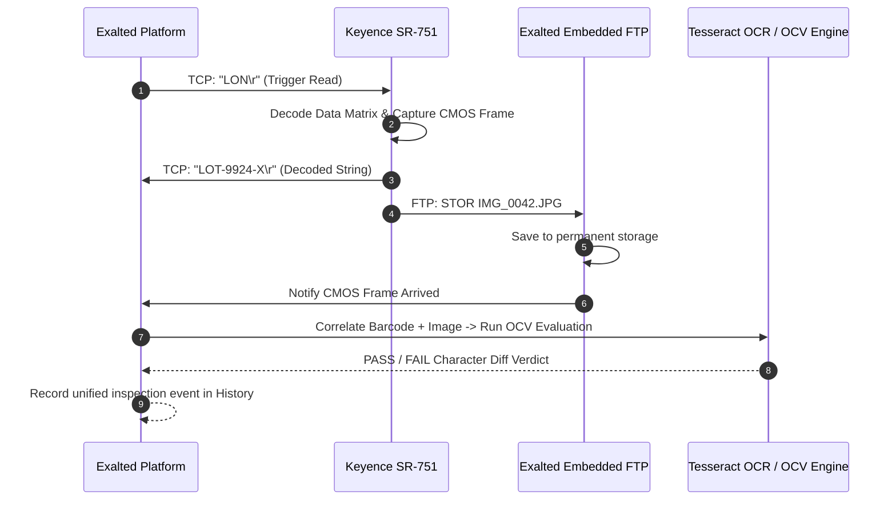

# Keyence SR-751 Integration & Protocol Guide

Version: 1.0.0  
Product: Exalted Industrial Machine Vision Platform  
Target Device: Keyence SR-750 / SR-751 / SR-752 Series 2D Code Readers

---

## 1. Network Topology & Hardware Setup

The Keyence SR-751 is an industrial Ethernet-enabled optical code reader capable of reading high-density Data Matrix codes, dot-peen markings, and standard 1D/2D barcodes on high-speed production lines.

```
       +---------------------------------------------+
       |             Keyence SR-751                  |
       |  IP: 192.168.100.100 / Subnet: 255.255.255.0|
       +----------------------+----------------------+
                              | Ethernet (M12 D-Code / RJ45)
                              v
       +---------------------------------------------+
       |         Industrial Ethernet Switch          |
       +----------------------+----------------------+
                              |
                              v
       +---------------------------------------------+
       |       Exalted Host Machine (PC / IPC)       |
       |  IP: 192.168.100.10  / Subnet: 255.255.255.0|
       |  TCP Command Client  <---> Port 9004        |
       |  Embedded FTP Server <---> Port 2121        |
       +---------------------------------------------+
```

### Hardware Connection Checklist:
1. **Power**: Supply 24 VDC ($\pm 10\%$) via the I/O cable or power supply module.
2. **Ethernet**: Connect the M12 4-pin D-coded Ethernet connector to the industrial switch or directly to the host PC's network card.
3. **Subnet Matching**:
   - Keyence default IP: `192.168.100.100` (or configured via Keyence AutoID Navigator).
   - Set the host computer's static IP to `192.168.100.10` with subnet `255.255.255.0`.
   - Verify connectivity via standard ping: `ping 192.168.100.100`.

---

## 2. TCP/IP Command Socket Protocol

Exalted communicates with the SR-751 using an asynchronous TCP socket client (`KeyenceSr751Client`).

### Protocol Framing:
- **Default Port**: `9004` (Command and data communication port).
- **Delimiter**: ASCII Carriage Return (`\r` or `\r\n`).
- **Response Format**: ASCII response string terminated with `\r`.

### Command Reference Table:

| Command | Parameter | Description | Typical Response |
| :--- | :--- | :--- | :--- |
| `LON` | None | Turn illumination on and trigger barcode reading. | `<Decoded String>\r` or `ERROR\r` |
| `LOFF` | None | Turn illumination off and terminate read cycle. | `OK\r` |
| `T1` | None | Start test / tuning read cycle. | `OK\r` or decoded data |
| `T2` | None | Stop test / tuning mode. | `OK\r` |
| `PRG` | `00`–`15` | Change active parameter bank (recipe). Example: `PRG,02`. | `OK\r` |
| `FTPOUT`| None | Command reader to transmit current image via FTP. | `OK\r` |
| `BEEP` | None | Trigger onboard buzzer signal. | `OK\r` |
| `KEYENCE`| None | Query reader firmware model and serial information. | `SR-751,V2.30...\r` |
| `STAT` | None | Query unit status and temperature. | `00\r` (00 = Normal) |

### Auto-Reconnect & Keepalive:
The `KeyenceSr751Client` features an automatic exponential backoff reconnection loop. If the network cable is momentarily disconnected or the unit power-cycles:
- Exalted detects socket closure.
- Attempts immediate reconnection after 1 second, doubling up to 16 seconds.
- Re-registers command listeners and resumes reading transparently upon reconnect.

---

## 3. Embedded Pure-Dart FTP Receiver (Port 2121)

To support complete offline machine vision without third-party FTP server dependencies (such as FileZilla, vsftpd, or IIS), Exalted integrates a native Dart FTP receiver (`KeyenceFtpReceiver`).

### Supported RFC 959 Protocol Commands:
- `USER <anonymous/user>`: Accepts any authentication credentials configured in the reader.
- `PASS <password>`: Accepted automatically.
- `TYPE <I/A>`: Sets image binary transfer mode (`IMAGE` / 8-bit bytes).
- `PASV`: Opens a dynamic passive listening port and returns `227 Entering Passive Mode (h1,h2,h3,h4,p1,p2)`.
- `PORT <h1,h2,h3,h4,p1,p2>`: Supports active mode image delivery back to the reader.
- `STOR <filename.bmp/jpg>`: Receives the raw CMOS image stream, writes it to the permanent image directory, and notifies the inspection pipeline.
- `QUIT`: Graceful session termination.

---

## 4. Automated CMOS Image & Barcode Inspection Pipeline

In production operations, verifying the 2D matrix code is often only half the requirement; the human-readable text (expiration date, lot number, serial number) must also match.

### Sequence of Operations:



1. **Trigger**: PLC or Exalted issues `LON`.
2. **Decode**: SR-751 reads the 2D Data Matrix code and responds with payload over TCP.
3. **Image Transfer**: SR-751 automatically sends the captured image via FTP to Exalted port 2121.
4. **Correlation**: `Sr751InspectionPipeline` correlates the TCP barcode event with the FTP image event.
5. **OCV Verification**: The image is cropped according to the active recipe ROI and verified against the designated OCV rule.
6. **Unified Record**: A single traceable record containing barcode payload, image path, OCR text, and verification status is stored.

---

## 5. Configuring Keyence AutoID Navigator

To configure the SR-751 to work with Exalted:

### Step 1: Network Settings
- Open **Keyence AutoID Navigator**.
- Connect to the reader via USB or direct Ethernet.
- Navigate to **Ethernet Settings**:
  - IP Address: `192.168.100.100`
  - Subnet Mask: `255.255.255.0`
  - Default Gateway: `192.168.100.1` (or blank if on isolated switch).

### Step 2: Communication Mode
- Under **Communication**, select **TCP Server**:
  - Port Number: `9004`
  - Delimiter: `CR` (or `CR+LF`).
  - Header: None.

### Step 3: FTP Image Transmission Settings
- Navigate to **Data Transfer > FTP Image Transmission**:
  - Enable **Transmit Image on Read / Failure**.
  - FTP Server IP: `<Host PC IP>` (e.g., `192.168.100.10`).
  - Port Number: `2121`.
  - User Name: `exalted`.
  - Password: `exalted`.
  - Directory: `/`.
  - File Format: `JPEG` or `BMP` (JPEG recommended for higher throughput).
- Click **Send Configuration to Reader** and restart the unit.

---

## 6. Production Best Practices & Diagnostics

1. **Dedicated Network Interface Card (NIC)**: For production lines exceeding 5 parts/second, install a dedicated second NIC on the host PC specifically for the camera network. This isolates camera traffic from plant-wide enterprise networks.
2. **Quiet Zone & Illumination**: Ensure the SR-751 internal polarizing filter is set appropriately for shiny metal parts (Direct Part Marking).
3. **Heartbeat Diagnostics**: Use Exalted's Diagnostics panel to test reader connection latency. Normal round-trip command latency should be $< 15$ ms.
